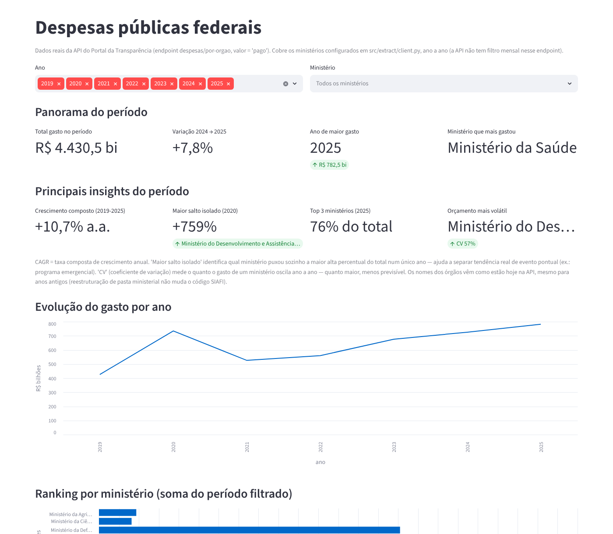

# Despesas Federais — Portal da Transparência

[](https://github.com/RMachado01/despesas-federais-transparencia/actions/workflows/ci.yml)


Pipeline de dados de ponta a ponta com **dados reais** da API do Portal da
Transparência: extrai as despesas públicas federais por ministério, limpa e
normaliza, grava num warehouse analítico em DuckDB e publica um dashboard em
Streamlit que **calcula os insights sozinho** (crescimento composto, saltos
isolados, concentração e volatilidade) a cada nova carga.



## Como funciona

```text
API do Portal da Transparência
    -> src/extract     baixa e salva o JSON cru, por ano + ministério (com retry)
    -> src/transform   limpa e normaliza
    -> src/load        grava no DuckDB (idempotente: recarregar um ano não duplica)
    -> run_pipeline.py orquestra tudo em sequência, por ano
    -> app/streamlit_app.py  dashboard que lê do DuckDB
```

**Decisões de projeto**

- **DuckDB** porque roda embutido (não precisa subir banco) e é rápido para
  consulta analítica.
- **Sem Airflow de propósito:** para o tamanho deste projeto, um script
  sequencial com log decente resolve. Um orquestrador seria complexidade sem
  necessidade.
- **Valor = `pago`:** a API devolve três estágios por registro (`empenhado`,
  `liquidado` e `pago`). Uso `pago`, que é o mais próximo de "dinheiro que
  realmente saiu do caixa".

### O que só descobri testando com token de verdade

O plano original era puxar a despesa mês a mês. Só que o endpoint
`despesas/por-orgao` **não tem filtro de mês**: aceita apenas `ano`
(obrigatório) + `pagina` e exige um `orgaoSuperior` (código SIAFI do
ministério), senão devolve erro 400 por falta de filtro mínimo.

Por isso o pipeline mudou de granularidade mensal para anual e passou a fazer
um loop por uma lista de ministérios (`ORGAOS_SUPERIORES` em
`src/extract/client.py`). No fim ficou melhor para o dashboard: comparação
ano a ano é o que mais se usa em análise de gasto público, e mês a mês geraria
ruído.

## Principais insights (dados reais, 2019–2025)

1. **Crescimento composto de 10,7% ao ano** entre 2019 e 2025 (CAGR).
2. **O salto de 2020 (+72% num ano) tem uma causa isolada:** o Ministério do
   Desenvolvimento Social cresceu **759%** naquele ano (auxílio emergencial da
   pandemia), enquanto o resto ficou estável ou caiu — Educação −4,5%, Ciência
   e Tecnologia −12,4%, Transportes −23,5%. Não foi "o governo gastando mais em
   geral", foi um programa específico.
3. **A reversão confirma a causa:** quando o auxílio acabou, o gasto total caiu
   **28,4% em 2021**, a maior queda da série.
4. **Concentração:** em 2025, três ministérios (Saúde, Educação e
   Desenvolvimento Social) respondem por **76,2%** do gasto dos 8 acompanhados.
5. **Volatilidade:** Desenvolvimento Social tem o orçamento mais errático
   (coeficiente de variação de 57%, sensível à política de transferência de
   renda). Defesa é o mais estável (6%).

Esses números aparecem como cards no dashboard ("Principais insights do
período") e **são recalculados automaticamente** quando o pipeline carrega
novos anos — não são valores fixos no código.

> **Ressalva:** a API devolve o nome *atual* do ministério para cada código
> SIAFI, mesmo em anos antigos. Por isso "Ministério do Desenvolvimento e
> Assistência Social" aparece com esse nome até em 2019. Não é erro no dado, é
> como a API trata reestruturação ministerial.

## Rodando localmente

```bash
pip install -r requirements.txt
streamlit run app/streamlit_app.py
```

O repositório já traz um `data/warehouse.duckdb` com dados reais de 2019 a
2025, então o dashboard abre direto.

### Atualizando os dados

1. Crie um token gratuito em
   <https://api.portaldatransparencia.gov.br/swagger-ui.html> (botão de
   cadastro no canto da página; o token chega por e-mail).
2. Copie `.env.example` para `.env` e coloque o token.
3. Rode o pipeline para os anos que quiser:

   ```bash
   python run_pipeline.py --ano 2025
   python run_pipeline.py --ano 2020 --ano 2021 --ano 2022
   ```

   Os dados daquele ano são substituídos no warehouse (pode rodar quantas vezes
   quiser, não duplica).

## Testes

```bash
pip install -r requirements-dev.txt
pytest -v
```

Os testes cobrem extração (incluindo retry e erros 4xx, com a API simulada via
`responses`), limpeza, carga no DuckDB e o pipeline completo. Rodam no GitHub
Actions a cada push e pull request.

## Próximos passos

- Buscar a lista de ministérios dinamicamente no endpoint `orgaos-siafi` em vez
  de uma lista fixa.
- Usar um endpoint mais granular (despesas por documento) para filtrar por
  favorecido.
- Agendar o pipeline (hoje o dashboard publicado é um snapshot).
- Ampliar os testes de erro da API.

## Fonte dos dados

[Portal da Transparência](https://portaldatransparencia.gov.br/) —
Controladoria-Geral da União (CGU).
